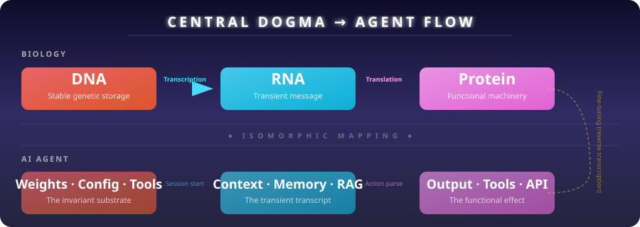
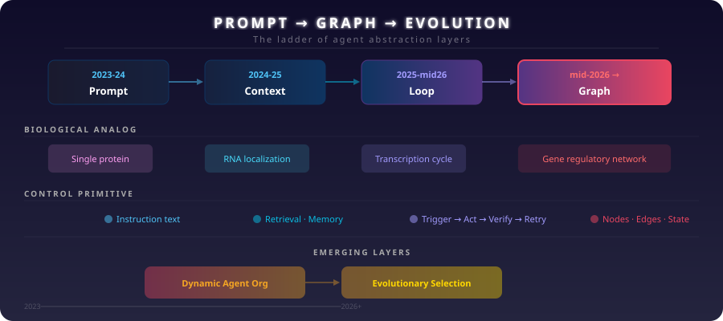
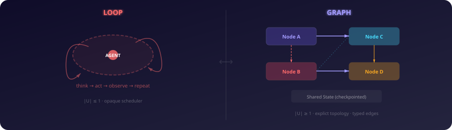

<p align="center">
  
</p>

<p align="center">
  <b>Biology's Central Dogma as a map for the Prompt → Loop → Graph → Evolution trajectory of AI agents.</b>
</p>

<p align="center">
  
</p>

---

**polymer** is a concept framework, skill prototype, and research scaffold that argues the central dogma of molecular biology (DNA → RNA → Protein) describes the same information-flow architecture emerging across AI agent evolution — from simple prompts through loops and graphs toward self-evolving digital organisms.

## The isomorphic mapping

| Biological | AI analog | What it enables |
|------------|-----------|-----------------|
| DNA (genotype) | Model weights, system config, tool definitions | Long-term information storage |
| DNA replication | Model distillation, checkpointing | Fidelity across generations |
| DNA repair (exonuclease) | Self-consistency, verifier loops | Error correction |
| Promoter / enhancer | System prompt, priming | Context-dependent expression |
| Transcription (DNA→RNA) | Inference forward pass, activation | Transient capability expression |
| RNA splicing | Context window management, RAG | Multiple outputs from one source |
| Translation (RNA→Protein) | Structured output, tool calls | From representation to action |
| Protein folding | Output formatting, chain-of-thought | Functional conformation |
| Protein function | Tool execution, API calls | Real-world effect |
| Regulatory feedback | Verifier gates, human-in-loop | Homeostasis, safety |
| Epigenetics | LoRA adapters, in-context learning | Plasticity without genome change |
| Horizontal gene transfer | Multi-agent communication (A2A, MCP) | Acquired capability across lineages |
| Evolution by selection | RLHF, benchmark-driven improvement | Generational improvement |

<p align="center">
  
</p>

## The Loops → Graphs phase shift (July 2026)

On July 18, 2026, **Peter Steinberger (@steipete)** posted six words that declared the loop engineering era over:

> "Are we still talking loops or did we shift to graphs yet?"

575K views in hours. The industry had just named "loop engineering" six weeks earlier — and the conversation had already moved. This repo analyzes that shift through the lens of biological regulatory evolution.

| Dimension | Loop | Graph |
|-----------|------|-------|
| Control primitive | Think → Act → Observe → Repeat | Nodes + Edges + State |
| Scheduler | Single-ready (\|U\| ≤ 1) | Multi-ready (\|U\| ≥ 1) |
| Dependencies | Implicit in context | Declared as edges |
| State | Transcript (growing context) | Typed, checkpointed object |
| Parallelism | Serial by design | Fan-out / fan-in |
| Recovery | Restart or context surgery | Retry node, skip, fallback |
| Audit trail | Scrolling a transcript | Per-edge state transitions |
| Failure mode | Infinite loop, drift | Structural fragility |
| Design ethos | "Agent figures it out" | "Declare the structure" |

**The insight**: Loops are not replaced — they are *demoted*. A loop is a single-node graph with an edge back to itself. Loops live *inside* nodes; the graph connects them. This is the same relationship transcription (a linear cycle) has to gene regulation (a network of cycles).

<p align="center">
  
</p>

## The Software Periodic Table connection

The [Software Periodic Table](https://github.com/NullLabTests/software-periodic-table) identifies ~115 recurring atoms of software (Objects, Properties, Actions, Interfaces, Intelligence, Rules). **polymer** provides the *reaction mechanism* — how information flows through those atoms in agent systems. The periodic table gives you the parts; the central dogma gives you the assembly line.

## Repository structure

```
.
├── README.md              ← this file
├── SKILL.md               ← drop-in skill for opencode / Claude Code / Codex
├── RESEARCH.md            ← testable hypotheses, experimental protocol
├── media/                 ← SVG diagrams
│   ├── central-dogma-flow.svg
│   ├── evolution-ladder.svg
│   ├── loop-vs-graph.svg
│   └── evolutionary-tiers.svg
├── docs/
│   ├── 01-central-dogma-map.md       ← full isomorphic mapping
│   ├── 02-loops-to-graphs.md         ← the July 2026 phase shift
│   ├── 03-lambda-calculus.md         ← λ_A, LLMbda formal foundations
│   ├── 04-biological-motifs.md       ← GRN → agent pattern library
│   ├── 05-evolutionary-tiers.md      ← T1–T5 ladder
│   ├── 06-periodic-table-bridge.md   ← how periodic table atoms connect
│   └── 07-practical-patterns.md      ← 10 actionable patterns
└── research/
    ├── references.md                 ← 45 annotated references
    └── open-questions.md             ← 22 open research questions
```

## Status

- **Concept**: Stable — the central dogma mapping, loops→graphs analysis, and T1–T5 framework are complete
- **Skill**: Draft — `SKILL.md` is ready for harness integration
- **Research**: Scaffold — hypotheses are formulated but untested
- **Code**: None yet — this is a pure concept repo

---

<p align="center">
  <sub>Not production software. A living research scaffold. Push pending inspection.</sub>
</p>